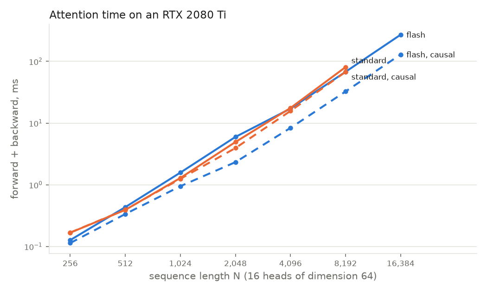
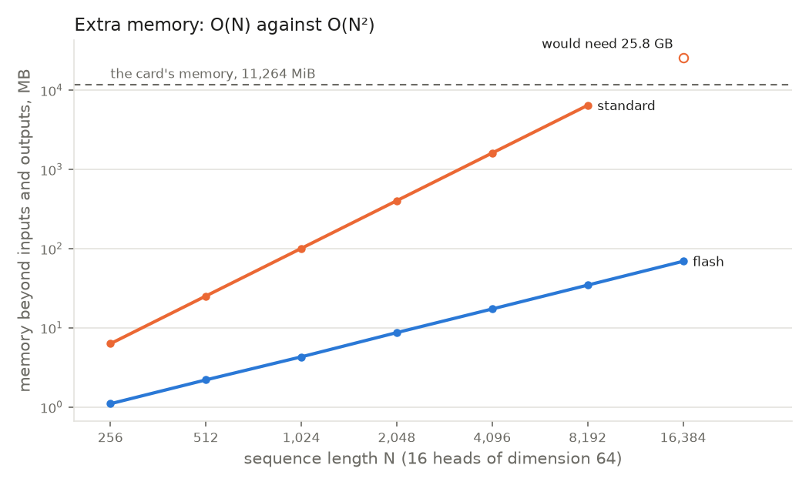

# FlashAttention-2 in CUDA on a Turing GPU

Exact attention, forward and backward, that never stores the N x N score matrix. This is
the FlashAttention-2 algorithm written from scratch in CUDA C++ on the tensor cores (WMMA),
for head dimension 64 in fp16. I compare it on an RTX 2080 Ti with standard attention
built the usual way, from cuBLAS matrix multiplies and a softmax kernel, and check both
against a float64 reference on the CPU.

Main results (times and memory at N = 8,192 unless noted):

- It's exact. On 14 test cases both methods are checked against float64: the output, the
  log-sum-exp and all three gradients, with and without a causal mask, for sequence
  lengths 1 to 333, including lengths that don't fill a tile. Flash's errors are 2e-4 to
  7e-4, about what fp16 storage gives on its own. They are equal to or below the standard
  method's in 41 of 48 comparisons and never more than twice it.
- Memory grows with N instead of N squared. With 16 heads, flash needs 35 MB beyond its
  inputs and outputs and standard attention needs 6.4 GB. At N = 16,384 standard
  attention would need 25.8 GB, which doesn't fit on the 11 GB card; flash runs it in
  270 ms.
- The forward pass is 2.1x faster, and 2.8x with the causal mask.
- The backward pass is 21% slower than cuBLAS-based attention without a mask and 1.8x
  faster with one. Standard attention computes the full N x N matrices either way, while
  flash skips the tiles the mask removes.
- Forward and backward together are 1.19x faster without a mask and 2.1x with it.
- It runs at 14 to 15 TFLOPS, a quarter of the tensor cores' 64 at this clock. Every score
  tile goes through shared memory for the softmax (see below), and that's the main cost and
  the first thing I'd change.

## How the kernels work

`src/flash.cuh` is about 360 lines.

Forward: a block of 4 warps owns 64 queries and walks over the keys 64 at a time. Each warp
computes its 16 x 64 tile of scores Q K^T on the tensor cores. It keeps a running row
maximum m and sum l, and rescales its output accumulator by exp(m_old - m_new) whenever
the maximum grows. That's the online softmax, so no full row is ever needed. At the end it
writes O = acc / l and the log-sum-exp L = m + log l for the backward pass. With the causal
mask a block stops at the diagonal.

Backward: a block owns 64 keys and walks over the query tiles. It rebuilds P = exp(S - L)
from the saved L instead of storing it, then forms dP = dO V^T and dS = P (dP - D), where
D = rowsum(dO * O). dK and dV for its keys accumulate in registers. dQ gets contributions
from every key block, so those are added into an fp32 buffer with atomics and converted to
fp16 at the end.

WMMA doesn't specify which thread holds which element of an accumulator, so the row-wise
max and sum can't be done in registers. The scores go to shared memory instead, two lanes
take each row, and the probabilities go back as fp16, written over the scores, for the next
multiply. The output accumulator is rescaled the same way. The forward pass uses 61 KB of
shared memory and the backward pass 63 KB, just under Turing's 64 KB per block.
Exponentials use exp2, which is one hardware instruction, with log2(e) folded into the
softmax scale.

`src/standard.cuh` is the baseline. It computes S = Q K^T into an fp32 N x N buffer, applies
a softmax kernel to get P in fp16, then O = P V. Its backward pass computes P^T dO, dO V^T,
dS and two more products, each over the N x N matrices. All the products are batched cuBLAS
calls with fp16 inputs and fp32 accumulation, the same as the flash kernels use. That's the
structure of a framework's plain attention path.

## Running it

Needs an NVIDIA GPU with tensor cores (compute capability 7.0 or newer; built here for 7.5).

```
make                     # build/attn_test and build/attn_bench
./build/attn_test        # 70 checks against the float64 reference; non-zero exit on failure
./build/attn_bench       # results/<gpu>/attention.csv
```

On a Slurm cluster, `jobs/slurm.sh` builds on the node, runs the tests (and stops if they
fail), then the benchmark:

```
sbatch -A <account> -p <partition> -C 2080ti -o logs/%x-%j.out \
       --export=ALL,CUDA_MODULE=<cuda module> jobs/slurm.sh
```

Report and charts: `.venv/bin/python analysis/report.py` (after
`uv venv && uv pip install matplotlib pytest`), then `.venv/bin/python -m pytest` for its
2 tests.

## Results

RTX 2080 Ti, CUDA 12.6, 16 heads of dimension 64 (batch 2 x 8 heads), fp16. Times are the
median of repeated runs after a warm-up. TFLOPS counts useful matrix-multiply work: 2
products forward and 5 backward, halved with the causal mask. Extra memory is everything
beyond Q, K, V, O, dO and the gradients. Every row is in `results/summary.md`.

No mask:

| N | flash fwd | standard fwd | flash bwd | standard bwd | flash TFLOPS | standard TFLOPS | flash extra | standard extra |
|---|---|---|---|---|---|---|---|---|
| 512 | 0.12 ms | 0.17 ms | 0.31 ms | 0.23 ms | 8.7 | 9.6 | 2.2 MB | 25 MB |
| 1,024 | 0.45 | 0.53 | 1.13 | 0.76 | 9.5 | 11.7 | 4.3 MB | 101 MB |
| 2,048 | 1.72 | 2.11 | 4.25 | 2.82 | 10.1 | 12.2 | 8.7 MB | 403 MB |
| 4,096 | 4.91 | 7.83 | 12.26 | 9.75 | 14.0 | 13.7 | 17 MB | 1.6 GB |
| 8,192 | 19.18 | 40.60 | 48.66 | 40.24 | 14.2 | 11.9 | 35 MB | 6.4 GB |
| 16,384 | 76.79 | does not fit | 193.71 | does not fit | 14.2 | | 69 MB | (25.8 GB) |

Causal:

| N | flash fwd | standard fwd | flash bwd | standard bwd | flash TFLOPS | standard TFLOPS |
|---|---|---|---|---|---|---|
| 512 | 0.09 ms | 0.17 ms | 0.24 ms | 0.23 ms | 5.6 | 4.8 |
| 1,024 | 0.27 | 0.49 | 0.68 | 0.76 | 7.9 | 6.0 |
| 2,048 | 0.68 | 1.44 | 1.64 | 2.50 | 12.9 | 7.6 |
| 4,096 | 2.50 | 5.95 | 5.85 | 9.79 | 14.4 | 7.6 |
| 8,192 | 9.76 | 27.31 | 22.78 | 40.24 | 14.8 | 7.1 |
| 16,384 | 38.34 | does not fit | 91.04 | does not fit | 14.9 | |





At every benchmark size flash's outputs agree with standard attention's to within 0.0005
without a mask. With the mask the gap is up to 0.002, about one fp16 rounding step at the
larger output values of the first few rows.

The unmasked backward pass is where flash loses. It does a sixth multiply (it recomputes
S), an fp32 atomic add for every element of dQ from every key block, and stages two tiles
through shared memory instead of one. Up to N = 8,192, cuBLAS's large products are efficient
enough to make up for their extra memory traffic.

For short sequences launch overhead dominates. At N = 256 everything takes about 0.1 ms,
and flash's single kernel beats the three launches of the standard forward pass.

## Tests

`build/attn_test` runs 14 cases (N = 1, 17, 64, 100, 128, 200, 333, with and without the
mask, 3 heads) and checks O, L, dQ, dK and dV for each against a float64 CPU reference.
The error is the largest absolute difference divided by the largest reference value, or
by 1 where that is smaller, since with a single key dQ and dK are exactly zero. O must be
within 4e-3, the gradients within 1e-2 and L within 2e-3 absolute, and flash must also be
no worse than twice the standard method plus 1e-3. Observed: flash's errors were 1.7e-4 to
6.5e-4 for N from 17 up, and about 1e-6 at N = 1.

My first error measure divided by the largest reference value even when it was zero. It
flagged both methods at N = 1, and the bug was in the measure, while the kernels were fine.

## Limits

- Head dimension 64 only, fp16 only, no dropout and no bias. Dimension 128 doesn't fit in
  64 KB of shared memory with this tiling.
- I didn't compare against PyTorch's own kernels (its memory-efficient attention for
  Turing). The baseline is standard attention built from cuBLAS, which has the structure of
  the math fallback but isn't its exact code.
- It isn't tuned. Keeping the scores in registers with explicit `mma.sync` layouts would
  remove the shared-memory round trip. Double buffering the K and V tiles would help too, as
  would the FlashAttention-2 trick of splitting the backward pass to avoid atomics. The
  profiler is restricted to administrators on this cluster, so I haven't measured which
  matters most.
- One GPU, with unlocked clocks.

## References

- T. Dao, D. Y. Fu, S. Ermon, A. Rudra, C. Ré, "FlashAttention: Fast and Memory-Efficient
  Exact Attention with IO-Awareness", 2022. https://arxiv.org/abs/2205.14135
- T. Dao, "FlashAttention-2: Faster Attention with Better Parallelism and Work
  Partitioning", 2023. https://arxiv.org/abs/2307.08691
- M. Milakov, N. Gimelshein, "Online normalizer calculation for softmax", 2018.
  https://arxiv.org/abs/1805.02867
- NVIDIA, CUDA C++ Programming Guide 12.6, warp matrix functions (WMMA).
